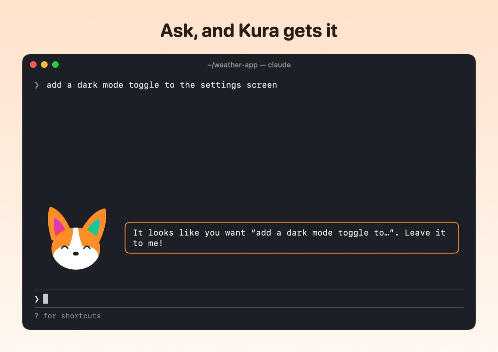
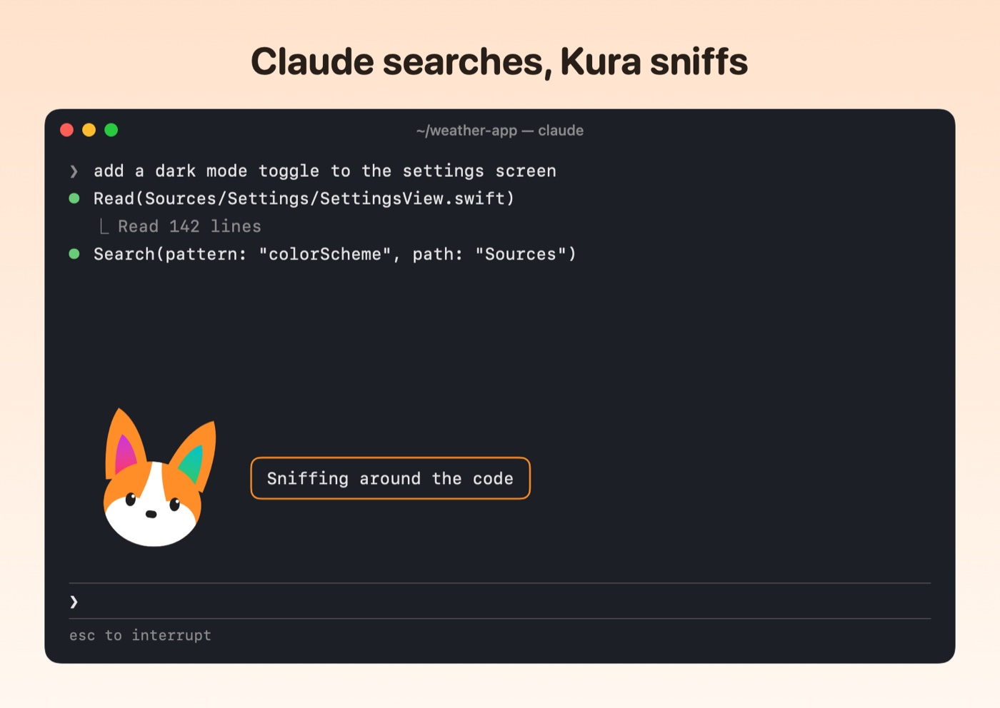
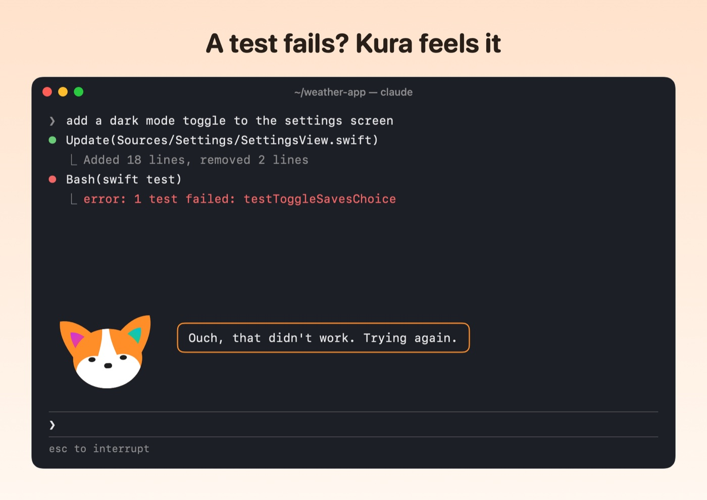
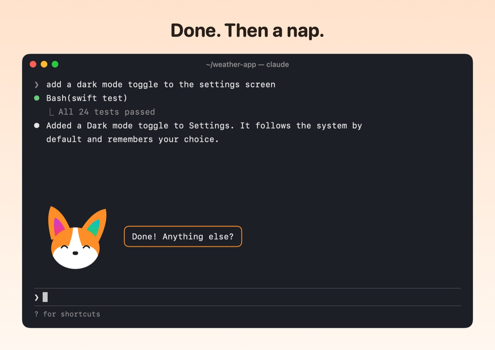

# Kura for Claude Code

Kura, the corgi-fox from [KuraNote](https://kuranote.app), lives above your Claude Code prompt
and reacts to what Claude is doing, like the paperclip of old office software, minus the annoying part.

- **Thinks** while Claude thinks, with his ears going back and forth
- **Reads** the file Claude opens, **sniffs around** when it searches the code, **snoops on the web**
- **Perks up his ears** while Claude writes code or runs a command (the bubble shows what it's doing)
- **Looks sorry** when something fails
- **Says "Done!"** with a happy face, then falls asleep after 90 seconds of quiet: eyes shut, breathing, Zz

When you send a message he does his best paperclip impression: *“It looks like you want…”*.


<table>
<tr>
<td></td>
<td></td>
</tr>
<tr>
<td></td>
<td></td>
</tr>
</table>

## Install

At the prompt of a Claude Code session in your terminal:

```
/plugin install kura --marketplace slade9220/kura-claude-code
```

Answer `y` to add the marketplace, then press Enter to install for your user. Kura shows up right away
and in every new session.

From a shell:

```bash
claude plugin install kura --marketplace slade9220/kura-claude-code
```

In the Claude desktop app: click **+** next to the prompt box, then **Plugins**, **Add marketplace**
with `slade9220/kura-claude-code`, then **Add plugin**.

## Which terminal

Kura is a real picture only in terminals that can draw images. Everywhere else he is made of
colored blocks: still Kura, but pixelated and a little bigger.

| Terminal | Kura |
| --- | --- |
| [Ghostty](https://ghostty.org), [kitty](https://sw.kovidgoyal.net/kitty/) (macOS, Linux) | Sharp, as in the app |
| macOS Terminal, iTerm2, Warp, VS Code | Colored blocks |
| Windows Terminal | Colored blocks |

- **macOS Terminal** can't show pictures inside the terminal, so there Kura is always made of blocks.
  For a sharp Kura, install Ghostty (`brew install --cask ghostty`). Your Claude Code settings stay
  the same; macOS asks once more for the permissions it gave to Terminal, like access to your Desktop.
- **Windows** has no Ghostty or kitty yet, so Kura is made of blocks; Windows Terminal draws them well.
  Set `KURA_LANG` to choose his language, since Windows doesn't tell him.
- If the colors look wrong, your terminal doesn't support 24-bit color.

## Options

- `/kura` hides Kura, or brings him back.
- He speaks English, Italian, French, Spanish, Portuguese and German, following your Mac's language
  or your locale. To choose, set `KURA_LANG` (for example `export KURA_LANG=it`).

## Privacy

Kura reads nothing and sends nothing anywhere. He only reacts to the events of your own session,
and the drawings ship with the plugin.

## License

The code is MIT. Kura is the mascot of [KuraNote](https://kuranote.app), an app that records,
transcribes and summarizes your meetings and lectures on iPhone, iPad and Mac.
