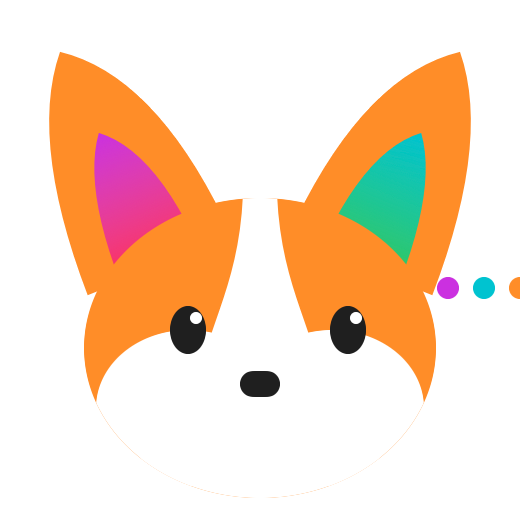

# Kura for Claude Code



Kura, the corgi-fox from [KuraNote](https://kuranote.app), lives above your Claude Code prompt
and reacts to what Claude is doing, like the paperclip of old office software, minus the annoying part.

- **Thinks** while Claude thinks, with his ears going back and forth
- **Reads** the file Claude opens, **sniffs around** when it searches the code, **snoops on the web**
- **Perks up his ears** while Claude writes code or runs a command (the bubble shows what it's doing)
- **Looks sorry** when something fails
- **Says "Done!"**, then falls asleep after 90 seconds of quiet

When you send a message he does his best paperclip impression: *“It looks like you want…”*.

## Install

At the prompt of a Claude Code session in your terminal:

```
/plugin install kura --marketplace slade9220/kura-claude-code
```

Answer `y` to add the marketplace, then press Enter to install for your user. Kura shows up right away
and in every new session.

From a shell:

```bash
claude plugin install kura --marketplace slade9220/kura-claude-code
```

In the Claude desktop app: click **+** next to the prompt box, then **Plugins**, **Add marketplace**
with `slade9220/kura-claude-code`, then **Add plugin**.

## Sharp or pixelated

- In **Ghostty** and **kitty** Kura is a real image, as sharp as in the app.
- In other terminals he is drawn with colored half blocks, so he looks a bit pixelated and needs
  a little more room. Your terminal needs 24-bit color.

## Options

- `/kura` hides Kura, or brings him back.
- He speaks English, Italian, French, Spanish, Portuguese and German, following your Mac's language
  or your locale. To choose, set `KURA_LANG` (for example `export KURA_LANG=it`).

## Privacy

Kura reads nothing and sends nothing anywhere. He only reacts to the events of your own session,
and the drawings ship with the plugin.

## License

The code is MIT. Kura is the mascot of [KuraNote](https://kuranote.app), an app that records,
transcribes and summarizes your meetings and lectures on iPhone, iPad and Mac.
